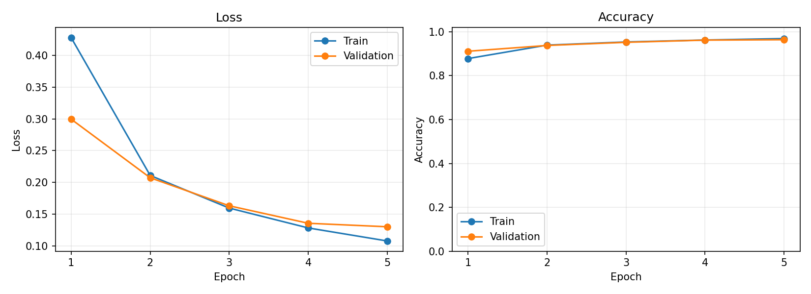
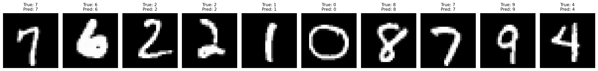
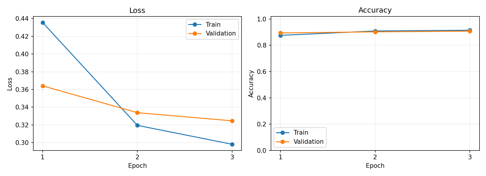

# 成员 6 整合基线结果

2026-11-23 在本地实际运行以下命令得到，使用 Python 3.9.6、NumPy 1.26.4、Matplotlib 3.9.4，随机种子 42。

```bash
python main.py train --config configs/mlp.json
python main.py train --config configs/cnn.json
```

两组均使用 55,000 张训练图片、独立的 5,000 张验证图片，最后评估官方 10,000 张测试图片。

| 配置 | 轮数 | 测试 Loss | Accuracy | Precision（macro） | Recall（macro） | F1（macro） |
|---|---:|---:|---:|---:|---:|---:|
| MLP：784→128→64→10，SGD 0.05 | 5 | 0.120285 | 96.31% | 96.2753% | 96.3319% | 96.2913% |
| CNN：4 个 3×3 卷积核→ReLU→Flatten→Linear，SGD 0.02 | 3 | 0.291089 | 91.90% | 92.1642% | 91.8176% | 91.8670% |

当前表格记录两份默认配置的运行结果。结构、学习率和轮数均有差异；正式的模型对比实验需先由小组确定统一评价方案，再在验证集选择配置。

每个模型目录保留实际配置、逐轮 CSV、完整精度指标和两张图片。权重由上述命令生成在 `results/<模型>/model.npz`；重载和单张 CNN 预测也已通过独立命令验证。

## MLP





## CNN




